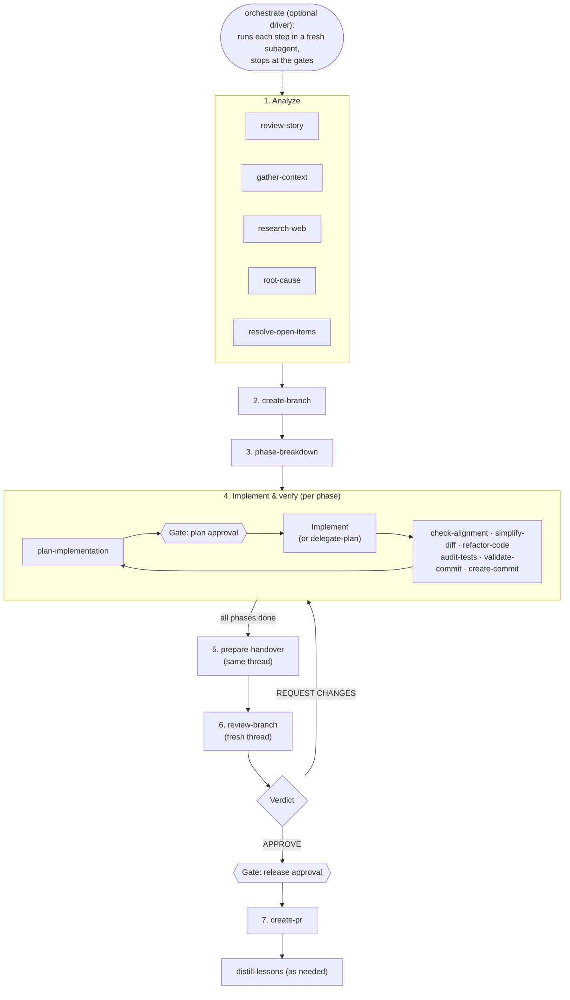

# Agentic Engineering Lifecycle Guide

The lifecycle splits one requirement into phases with explicit human gates: analyze, branch, plan, implement and verify, hand over, review in a fresh thread, and release. Run each skill by hand, or let `orchestrate` drive the whole run.

---

## 1. Overview



---

## 2. Phases

Each skill's description is in the [Skills Index](README.md#skills-index).

### Analyze
Before touching a branch, run whichever of `review-story`, `gather-context`, `research-web`, and `root-cause` the task needs. When a review, plan, or check leaves open items, `resolve-open-items` researches each one and returns what it settled and what needs your decision.

### Branch and break down
`create-branch` starts the feature branch from the latest default branch; `phase-breakdown` splits a large change into small, independently verifiable phases.

### Plan, implement, verify
For each phase, `plan-implementation` writes the plan before any code. Save the approved plan to `~/.agent-workflows/<repo>/<branch>/plan.md`; `delegate-plan` and `check-alignment` read it from there by default. It holds the current phase's plan, replaced each phase. Implement it yourself or hand it to another agent with `delegate-plan`; when a delegated agent reports back, run `check-alignment` before trusting the result.

Then verify as needed: `check-alignment` against the plan, `simplify-diff` for cuts, `refactor-code` for structure, `audit-tests` when the suite itself is in question, `validate-commit` before committing, and `create-commit` to commit.

### Hand over, review, release
`prepare-handover` closes the implementation thread, `review-branch` reviews it in a fresh one, `create-pr` opens the pull request, and `distill-lessons` records anything durable learned along the way. To report feedback on these skills themselves, `triage-feedback` files it into this project's issue backlog.

**Thread boundary.** Review quality drops as a conversation grows, so the review runs with a clean context:

1.  Run `prepare-handover` in the implementation thread. It writes `~/.agent-workflows/<repo>/<branch>/handover.md`.
2.  Open a new thread and run `review-branch`, which reads that handover.
3.  On `REQUEST CHANGES`, resolve the findings in the implementation loop and review again. On `APPROVE`, run `create-pr`.

In these paths `<repo>` is the main repository's directory name (shared by its worktrees) and `<branch>` is the current branch; each `/` in a branch name is a nested directory.

---

## 3. Orchestrated Mode

`orchestrate` drives one requirement end to end. When the breakdown yields one layer, it works on one branch; when it yields several, it builds a stack of branches with gh-stack, one pull request per layer, bottom first. Each step goes to a fresh `orchestrate-step` subagent with no conversation history, so every step, `review-branch` included, starts with a clean context. The orchestrator only coordinates and keeps its state under `~/.agent-workflows/<repo>/`; it never edits code.

What you do at each touchpoint:

*   **Story review**: read the Settled list (override any item you disagree with), answer the Needs you questions, and confirm or replace the proposed stack name; an unanswered item proceeds on its recommended option.
*   **Plan approval** (each layer): the plan comes with Settled and Needs you lists; reply `approve` (which accepts each Needs you item's recommended option), or give feedback for a revised plan. A plan that follows a tier escalation says so, with the reason. No code is written before approval.
*   **Release approval** (each layer): read the diff summary, review verdict, numbered findings (each with a recommended action and tier), handover, scope reductions, and the pull request title and body. Reply `approve` to open the pull request with that text, `redraft` with feedback to change only the text, `fix 3, 5` to fix listed findings at the highest of their tiers (large if any is large, else small), or `fix small: …` / `fix large: …` with feedback (small: a delta plan and a fix pass; large: a revised plan and plan approval). Untagged feedback gets a proposed tier and one stop; answer `small` or `large`. If the worker may not open it, it pushes the branch and hands you the approved title and body; open the pull request, then invoke `orchestrate` again.
*   **BLOCKED**: read the reported cause, then reply `fix` with direction, `re-plan` with optional feedback, `retry` (re-run the failed step unchanged, for example after fixing the environment), or `adopt` (accept the branch as it now stands; `adopt` also clears a halt on a moved branch tip). Once the plan is approved, `fix` takes the same `small:` / `large:` tag. After a rebase conflict, run the named rebase command by hand, do not push the branch, and reply `adopt`. Before a branch exists, reply `fix` with direction or `retry`. Any other halt is cleared by fixing its cause and invoking `orchestrate` again, unless the halt names a reply (such as `narrow`).
*   **Review comments**: `address <PR number>` on any open pull request, or `reopen` on a released layer, fetches the review, triages each comment (action, tier, and other instances of the same mistake) and stops. Reply `fix 2, 4`, tagged feedback, or `adopt` when nothing needs code. Draft replies in `replies.md` are shown at Release approval; post them yourself after release.
*   **Before the layers are approved**: `register <PR number>` builds the stack on an existing open pull request.
*   **Any time**: `abandon` drops the run's state and keeps the branches and pull requests.

To resume, invoke `orchestrate` again on the layer's branch, or with the stack name before a branch exists. It halts when a pull request was closed with a layer above it; reopen the pull request to continue.

**Requirements**: the `gh` CLI, authenticated. A stack also needs gh-stack 0.2.1 or later (`gh extension install github/gh-stack`), Git 2.36 or later, and a github.com repository; without them, `orchestrate` offers to narrow the requirement to one branch with the `narrow` reply.

Without subagents, `orchestrate` halts; use the skills one by one.

State files, drift checks, retries, and gate rules are defined in [skills/orchestrate/SKILL.md](skills/orchestrate/SKILL.md).

---

## 4. Stack Maintenance After Release

Once layers are open as pull requests, addressing review comments, rebasing, and merging are manual and yours. Do this only while `orchestrate` is not acting on the stack: no layer is active, or the run is waiting at a gate or BLOCKED. For a review on any open layer, with no layer active, you can instead reply `reopen` with the review, which may carry a `small:` or `large:` tag, and `orchestrate` runs that layer back through the lifecycle and refreshes its pull request text, shown at Release approval. It then syncs, restacks and validates the layers above, and pushes them atomically; reply `redraft` there for any change the review asks of the text itself. On its next run, `orchestrate` accepts a moved layer automatically only when the layer's patches are unchanged, a pure rebase onto its parent. Any edit to the layer it is working on makes its next run halt until you reply `adopt`.

Once per clone, run `git config rerere.enabled true`. A layer checked out in a linked worktree can be edited only in that worktree, and `gh stack rebase --upstack` refuses while the worktree of any affected layer is dirty.

For a review comment on any released layer:

1.  **Sync**: `gh stack checkout`, then `git fetch origin`. For each unmerged layer `<b>` that exists on origin, this must print nothing:
    ```bash
    git log --oneline --cherry-pick --right-only <b>...origin/<b> --not origin/<trunk>
    ```
    A listed commit is safe to ignore only if it is your own pre-rebase version of a commit: it is reachable from an entry of `git rev-list -g <b>` and its author and subject match one of your rewritten commits, or, after a merge, it is one of the merged layer's commits or GitHub's rewrite of one (`gh pr view <pr> --json commits` lists them). Otherwise someone else pushed it: stop and integrate it, for example `git cherry-pick <sha>` onto your local `<b>`, then run the check again. Then, from the bottom layer, run `gh stack rebase --upstack`. Do not use `gh stack sync` or `gh stack push` anywhere in maintenance: both force-push with leases from their own fetch, and `push` is not atomic.
2.  **Check the parent**: on the layer to edit, `git merge-base --is-ancestor <parent> HEAD` must succeed; otherwise stop.
3.  **Edit** the layer, then run `validate-commit` and `create-commit`.
4.  **Restack**: from the edited layer, run `gh stack rebase --upstack`, then `validate-commit` on each branch above it.
5.  **Push**: `gh stack rebase` fetches unless given `--no-trunk`, so run `git fetch origin` and the step 1 check again. After integrating any listed commit as step 1 says, repeat from step 4 (restack the layers above and re-validate) before recording leases. Record `git rev-parse origin/<b>` for each unmerged layer that exists on origin, then, with no fetch in between, push all of them in one atomic push leasing each ref on its recorded SHA:
    ```bash
    git push --atomic origin \
      --force-with-lease=refs/heads/<b1>:<sha1> --force-with-lease=refs/heads/<b2>:<sha2> \
      refs/heads/<b1>:refs/heads/<b1> refs/heads/<b2>:refs/heads/<b2>
    ```
    Afterwards `git ls-remote origin` must show each layer at its local tip. A rejection pushes nothing; retry from the fetch.
6.  **Merge** the bottom layer with `gh stack merge <pr> --squash|--rebase|--merge --yes`. A bare number is tried first as a stack number, then as a PR number, and `--yes` skips confirmation, so first confirm `<pr>` is not in the stack numbers that `gh api --paginate repos/<owner>/<repo>/stacks --jq '.[].number'` lists. Plain `gh pr merge` is refused for stacked pull requests.
7.  **Verify** after a merge: run `git fetch origin`. GitHub retargets the next pull request to trunk and rewrites the branches above, so the next maintenance starts at step 1. Record `git rev-parse <b>` for each remaining layer as its old tip. On the lowest remaining layer `<b>`, `git log origin/<trunk>..<b>` must list only its own commits. Otherwise run `git rebase --onto origin/<trunk> <headRefOid> <b>`, taking the merged PR's `headRefOid` from `gh pr view <pr> --json headRefOid` (it is the exact tip GitHub merged, independent of the state of your local branch). Then, from that layer, run `gh stack rebase --upstack`; if gh-stack refuses, rebase each layer above in order with `git rebase --onto <parent> <parent's old tip> <b>`. On each layer above, `git log <parent>..<b>` must list only that layer's own commits. Then push as in step 5.

When a pull request merges, `orchestrate` deletes that layer's state on its next run; maintenance never writes it.
