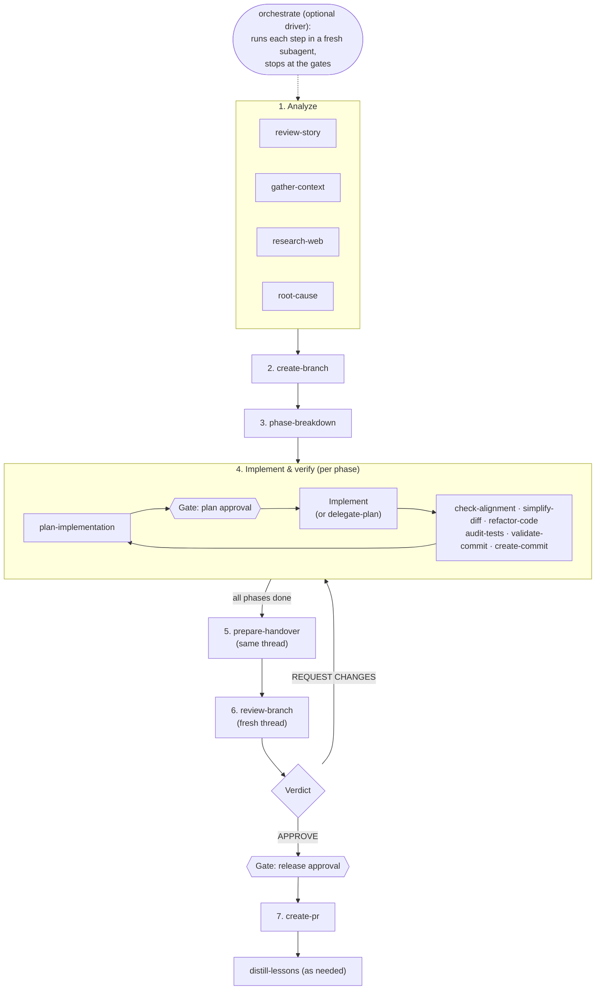

# Agentic Engineering Lifecycle Guide

The lifecycle splits one requirement into phases with explicit human gates: analyze, branch, plan, implement and verify, hand over, review in a fresh thread, and release. Run each skill by hand, or let `orchestrate` drive the whole run.

Skill descriptions below match the frontmatter in each `SKILL.md`, which is authoritative (see [AGENTS.md](AGENTS.md)).

---

## 1. Overview



---

## 2. Phases

### Analyze
Pick whichever utilities the task needs before touching a branch:

*   **`review-story`**: Audit a user story for gaps, conflicts, and missing detail. Use before planning or implementing a requirement.
*   **`gather-context`**: Gather and organize context for a given file, folder, or component before planning or coding. Use when starting work on unfamiliar code.
*   **`research-web`**: Research current best practices and trade-offs from authoritative sources. Use when a decision needs external evidence.
*   **`root-cause`**: Investigate an issue to identify its root cause with evidence before proposing fixes. Use when debugging.

### Branch and break down
*   **`create-branch`**: Check out the latest default branch and create a new feature branch using Conventional Commits. Use when starting new work.
*   **`phase-breakdown`**: Divide a large change into small, independently verifiable phases. Use before planning implementation of a complex task.

### Plan, implement, verify
For each phase, plan before code:

*   **`plan-implementation`**: Create a detailed implementation plan for a change, including risk-based test scenarios, and surface open questions and assumptions. Use before writing code or tests.
*   **`delegate-plan`**: Generate a self-contained prompt for another agent to execute an approved implementation plan. Use after a plan is approved and before implementation.

Save the approved plan to `~/.agent-workflows/<repo>/<branch>/plan.md`; `delegate-plan` and `check-alignment` read it from there by default. It holds the current phase's plan, replaced each phase. When a delegated agent reports back, run `check-alignment` before trusting the result.

Then use the verification utilities as needed:

*   **`check-alignment`**: Verify the actual diff against the agreed plan and the project's standards, and report ALIGNED or GAPS without editing. Use after implementing a change and before review.
*   **`simplify-diff`**: Audit the work in flight for over-engineering and unnecessary code, and report the cuts that would shrink the diff without applying them. Use when a change is correct but larger than it needs to be.
*   **`refactor-code`**: Audit structural design problems and apply the behavior-preserving restructure after approval. Use when code needs restructuring rather than subtraction.
*   **`audit-tests`**: Audit an existing test suite for quality anti-patterns and produce a prioritized improvement plan. Use when test quality itself is the subject, not the tests for a specific change.
*   **`validate-commit`**: Run formatters, linters, build, and tests to confirm code is ready to commit. Use before committing.
*   **`create-commit`**: Stage the in-scope changes and commit them with a message matching the repository's convention. Use after a logical piece of work is complete and verified.

### Hand over, review, release
*   **`prepare-handover`**: Summarize completed work, key decisions, and verification evidence for a reviewer. Use at the end of an implementation thread.
*   **`review-branch`**: Review the active branch diff against its target branch. Use in a fresh thread before opening a pull request.
*   **`create-pr`**: Push the current branch and open a pull request with a synthesized title and description. Use when a reviewed branch is ready to submit.
*   **`distill-lessons`**: Codify durable lessons from recent work into project guidelines or documentation. Use sparingly, after a notable discovery.

**Thread boundary.** Review quality drops as a conversation grows, so the review runs with a clean context:

1.  Run `prepare-handover` in the implementation thread. It writes `~/.agent-workflows/<repo>/<branch>/handover.md`.
2.  Open a new thread and run `review-branch`, which reads that handover.
3.  On `REQUEST CHANGES`, resolve the findings in the implementation loop and review again. On `APPROVE`, run `create-pr`.

In these paths `<repo>` is the main repository's directory name (shared by its worktrees) and `<branch>` is the current branch; each `/` in a branch name is a nested directory.

---

## 3. Orchestrated Mode

`orchestrate` drives one requirement end to end. When the breakdown yields one layer, it works on one branch; when it yields several, it builds a stack of branches with gh-stack, one pull request per layer, bottom first. Each step goes to a fresh `orchestrate-step` subagent with no conversation history, so every step, `review-branch` included, starts with a clean context. The orchestrator only coordinates and keeps its state under `~/.agent-workflows/<repo>/`; it never edits code.

What you do at each touchpoint:

*   **Story review**: answer the numbered questions from `review-story`, and confirm or replace the proposed stack name.
*   **Plan approval** (each layer): reply `approve`, or give feedback for a revised plan. No code is written before approval.
*   **Release approval** (each layer): read the diff summary, review verdict, handover, and scope reductions; reply `approve` to open the pull request, or give feedback for another fix pass.
*   **BLOCKED or halted**: read the reported cause, then reply `fix` with direction, `re-plan`, or `adopt` (accept the branch as it now stands). Before a branch exists, `abandon` drops the run.

To resume, invoke `orchestrate` again on the layer's branch, or with the stack name before a branch exists. It also stops while a lower layer must merge before the next can start; invoke it again after the merge.

**Requirements**: the `gh` CLI, authenticated. A stack also needs gh-stack 0.2.1 or later (`gh extension install github/gh-stack`) and a github.com repository; without them, `orchestrate` offers to narrow the requirement to one branch.

**Without subagents**: if the host cannot dispatch an `orchestrate-step` subagent, `orchestrate` prints each step's prompt instead. Run it in a fresh thread and paste the report back.

State files, drift checks, retries, and gate rules are defined in [skills/orchestrate/SKILL.md](skills/orchestrate/SKILL.md).

---

## 4. Stack Maintenance After Release

Once layers are open as pull requests, addressing review comments, rebasing, and merging are manual and yours. Do this only while `orchestrate` is not acting on the stack: no layer is active, or the run is waiting at a gate or BLOCKED. `orchestrate` re-anchors on its next run.

1.  **Prepare**: `git config rerere.enabled true`, `gh stack checkout`, `git fetch origin`.
2.  **Check for remote-only commits** on each layer `<b>`. This must print nothing; otherwise integrate those commits first:
    ```bash
    git log --oneline --cherry-pick --right-only <b>...origin/<b> --not origin/<trunk>
    ```
3.  **Rebase**: from the bottom layer, `gh stack rebase --upstack`.
4.  **Edit** the layer that needs the change, then run `validate-commit` and `create-commit`.
5.  **Restack**: `gh stack rebase --upstack`, then run `validate-commit` on each branch above the edited one.
6.  **Push** every unmerged layer in one atomic push, leasing each ref on the origin SHA you recorded before pushing (`git rev-parse origin/<b>`). Do not use `gh stack sync` or `gh stack push` here.
    ```bash
    git push --atomic origin \
      --force-with-lease=refs/heads/<b1>:<sha1> --force-with-lease=refs/heads/<b2>:<sha2> \
      <b1> <b2>
    ```
7.  **Merge** the bottom layer with `gh stack merge <pr> --squash|--rebase|--merge --yes`. Plain `gh pr merge` is refused for stacked pull requests.
8.  **Verify** after a merge: on each remaining layer, `git log origin/<trunk>..HEAD` must list only that layer's own commits. If it lists the merged layer's commits too, run `git rebase --onto origin/<trunk> <merged PR headRefOid>` (from `gh pr view <pr> --json headRefOid`).
