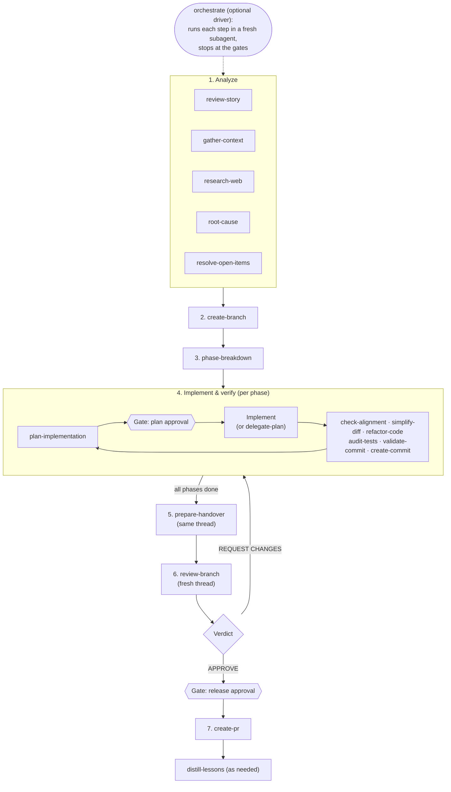

# Agentic Engineering Lifecycle Guide

The lifecycle splits one requirement into phases with explicit human gates: analyze, branch, plan, implement and verify, hand over, review in a fresh thread, and release. Run each skill by hand, or let `orchestrate` drive the whole run.

---

## 1. Overview



---

## 2. Phases

Each skill's description is in the [Skills Index](README.md#skills-index).

### Analyze
Before touching a branch, run whichever of `review-story`, `gather-context`, `research-web`, and `root-cause` the task needs. When a review, plan, or check leaves open items, `resolve-open-items` researches each one and returns what it settled and what needs your decision.

### Branch and break down
`create-branch` starts the feature branch from the latest default branch; `phase-breakdown` splits a large change into small, independently verifiable phases.

### Plan, implement, verify
For each phase, `plan-implementation` writes the plan before any code. Save the approved plan to `~/.agent-workflows/<repo>/<branch>/plan.md`; `delegate-plan` and `check-alignment` read it from there by default. It holds the current phase's plan, replaced each phase. Implement it yourself or hand it to another agent with `delegate-plan`; when a delegated agent reports back, run `check-alignment` before trusting the result.

Then verify as needed: `check-alignment` against the plan, `simplify-diff` for cuts, `refactor-code` for structure, `audit-tests` when the suite itself is in question, `validate-commit` before committing, and `create-commit` to commit.

### Hand over, review, release
`prepare-handover` closes the implementation thread, `review-branch` reviews it in a fresh one, `create-pr` opens the pull request, and `distill-lessons` records anything durable learned along the way. To report feedback on these skills themselves, `triage-feedback` files it as issues in this project's backlog.

**Thread boundary.** Review quality drops as a conversation grows, so the review runs with a clean context:

1.  Run `prepare-handover` in the implementation thread. It writes `~/.agent-workflows/<repo>/<branch>/handover.md`.
2.  Open a new thread and run `review-branch`, which reads that handover.
3.  On `REQUEST CHANGES`, resolve the findings in the implementation loop and review again. On `APPROVE`, run `create-pr`.

In these paths `<repo>` is the main repository's directory name (shared by its worktrees) and `<branch>` is the current branch; each `/` in a branch name is a nested directory.

---

## 3. Orchestrated Mode

`orchestrate` drives one requirement end to end. When the breakdown yields one layer, it works on one branch; when it yields several, it builds a stack of branches with gh-stack, one pull request per layer, bottom first. Each step goes to a fresh subagent with no conversation history: `orchestrate-step-light`, on a mid-tier model, for steps whose output a later step or you check, and `orchestrate-step` for those whose mistakes nothing later catches, as the step table in the orchestrate dispatch reference states, so every step, `review-branch` included, starts with a clean context. After plan approval, each layer runs three steps: implement (which also simplifies its own diff), validate (which also writes the handover), and `review-branch`, which checks the diff against the plan and gives each finding a recommended action and tier. The orchestrator only coordinates and keeps its state under `~/.agent-workflows/<repo>/`; it never edits code. Workers write their full reports, the context and the plan to that folder and return a short summary with the report's path. The orchestrator's thread holds paths and summaries, and it opens a report only to show it to you.

Start with a prompt like this, or with free text, a file, or a link; every label is optional and the whole message is taken as the requirement. To run unattended, start with `/orchestrate unattended` instead (see Unattended run below).

```
/orchestrate
Requirement: <what to build or fix; a ticket key such as ID-123 helps>
Sources: <links, files, or issues to read>
Constraints: <scope limits, standards, things not to touch>
Stack name: <optional; default is the ticket key or a slug of the title>
```

What you do at each touchpoint:

*   **Story review**: read the Settled list (override any item you disagree with), answer the Needs you questions, and note that the stack name defaults to the ticket key or a slug of the title (reply with another to replace it; you are asked only if that name is taken); an unanswered item proceeds on its recommended option.
*   **Plan approval** (each layer): the plan comes as a short summary (scope, risks, open questions) with a link to `plan.md`, and the Settled and Needs you lists; reply `approve` (which accepts each Needs you item's recommended option), or give feedback for a revised plan. No code is written before approval.
*   **Release approval** (each layer): read the diff summary, review verdict, numbered findings (each with the reviewer's recommended action and tier), handover, and the pull request title and body. Reply `approve` to open the pull request with that text, `redraft` with feedback to change only the text, `fix 3, 5` to fix listed findings at the highest of their tiers (large if any is large, else small), or `fix small: …` / `fix large: …` with feedback (small: a short fix pass that re-validates and re-reviews only the fix, and stops if the fix needs more than the plan allows; large: a revised plan and plan approval). Untagged feedback is small. The verdict can read `REQUEST CHANGES`: automatic rounds fix small Critical and Important findings and stop when a round raises no new one, or when a finding needs a larger change or your call. If the worker may not open it, it pushes the branch and hands you the approved title and body; open the pull request, then invoke `orchestrate` again.
*   **BLOCKED**: read the reported cause, then reply `fix` with direction, `re-plan` with optional feedback, `retry` (re-run the failed step unchanged, for example after fixing the environment), or `adopt` (accept the branch as it now stands; `adopt` also clears the halt on a branch tip that moved outside a step, for example after you rebased or committed by hand at a gate). Once the plan is approved, `fix` takes the same `small:` / `large:` tag. After a rebase conflict, run the named rebase command by hand, do not push the branch, and reply `adopt`. Before a branch exists, reply `fix` with direction or `retry`. Any other halt is cleared by fixing its cause and invoking `orchestrate` again, unless the halt names a reply (such as `narrow`).
*   **Review comments**: `address <PR number>` with that open pull request's branch checked out, or `reopen` on a released layer, fetches the review, triages each comment (action, tier of small or large, and other instances of the same mistake), shows what each reply runs and skips, and stops. It does not rebase onto a moved trunk; rebase by hand per section 4. Reply `fix 2, 4`, tagged feedback, or `adopt` when nothing needs code; `adopt` with nothing changed only drafts replies, and otherwise runs the full implementation loop, whose validation step can commit. A small fix runs the short fix path, and Release approval lists this round's commits. Draft replies in `replies.md` are shown at Release approval; post them yourself after release.
*   **Before the layers are approved**: `register <PR number>` builds the stack on an existing open pull request.
*   **Close-out**: once every pull request has merged or closed, invoke `orchestrate` with `<name> close-out` in a fresh thread. It inventories the follow-ups the change created (handover follow-ups, deferred findings and open items, unfiled out-of-scope findings, stale docs, and ticket state) and checks each item's premise. The gate lists the items as `C1`, `C2`, ...: `approve` runs all but ticket writes and branch deletion, `approve C2, C4` runs exactly those, and any other text revises the list. Repo edits become a brief for a new run, comments and chat messages are drafts for you to post, and merged local branches are deleted only when approved. The state folders are then removed.
*   **Unattended run**: start with `/orchestrate unattended <requirement>` (any case, `$orchestrate` where the host uses `$`), or, on a host with no skill command, put a line that is just `unattended` in the first paragraph. Doing so consents to pushing branches and opening draft pull requests without your approval. The run then answers story review, split approval, Plan approval, and Release approval with their recommendations (each logged in `decisions.md` as `(auto: unattended)` and listed in the next report), opens draft pull requests, auto-fixes review findings of any severity recommended as small fixes (Suggestions and Nitpicks in at most one pass per branch), and stops only at BLOCKED, a halt, a `large` or `re-plan` need, a Needs you item with no recommendation, or Release approval with an unresolved Critical or Important or a `discuss` finding. Fresh runs only: `address`, `reopen`, and `close-out` stay attended. If the message has something close to it but not one of those forms, such as `Unattended: yes`, the run asks you once whether to run unattended before any work starts: `yes` runs unattended, any other reply runs attended. There is no spend, turn, or time cap yet.
*   **Any time**: `abandon` drops the run's state and keeps the branches and pull requests. `abandon <path>` deletes a leftover story-review folder that Start lists.

Where the host has a structured question tool, the gates show their verbs as buttons. Picking one that takes text or numbers (`fix`, `redraft`, `narrow`, `re-plan`) is followed by a typed turn for the text or numbers, and plan feedback is always typed in chat. Typing the verb always works. An unattended run shows buttons only at the stops it makes.

To resume, invoke `orchestrate` again in the run's worktree, on the layer's branch, or with the stack name before a branch exists, or with its provisional path during story review. The first stop in a thread that waits for your reply ends with that command, and so does a stop where it changes; text after it is your reply, so you can move to a new thread at any stop that waits for a reply: the state folder holds every identifier, answer, and ruling, and the old thread holds nothing more. Use one thread per stack at a time. It also stops when three layers are open, the most it allows, until the lowest one merges; invoke it again after the merge. It halts when a pull request was closed with a layer above it; reopen the pull request to continue.

**Requirements**: the `gh` CLI, authenticated. A stack also needs gh-stack 0.2.1 or later (`gh extension install github/gh-stack`), Git 2.36 or later, and a github.com repository; without them, `orchestrate` offers to narrow the requirement to one branch with the `narrow` reply.

Without subagents, `orchestrate` halts; use the skills one by one.

State files, drift checks, retries, and gate rules are defined in [skills/orchestrate/](skills/orchestrate/).

---

## 4. Stack Maintenance After Release

Once layers are open as pull requests, addressing review comments, rebasing, and merging are manual and yours. Do this only while `orchestrate` is not acting on the stack: no layer is active, or the run is waiting at a gate or BLOCKED. For a review on any open layer, with no layer active, you can instead reply `reopen` with the review, which may carry a `small:` or `large:` tag, and `orchestrate` first checks for commits others pushed and requires the layers below to match origin, then runs that layer back through the lifecycle and refreshes its pull request text, shown at Release approval. At release it restacks the layers above, validates each that moved, and pushes it and them atomically; if any of that fails, finish by hand with steps 4-5 and invoke `orchestrate` again. For a review asking for a change to the text itself, reply `redraft` at Release approval. Any move of the layer `orchestrate` is working on, made outside one of its steps (an edit, or a rebase while it waits at a gate), makes its next run halt until you reply `adopt`, which re-validates and re-reviews the branch.

Once per clone, run `git config rerere.enabled true`. A layer checked out in a linked worktree can be edited only in that worktree, and `gh stack rebase --upstack` refuses while the worktree of any affected layer is dirty.

For a review comment on any released layer:

1.  **Sync**: `gh stack checkout`, then `git fetch origin`. For each unmerged layer `<b>` that exists on origin, this must print nothing:
    ```bash
    git log --oneline --cherry-pick --right-only <b>...origin/<b> --not origin/<trunk>
    ```
    A listed commit is safe to ignore only if it is your own pre-rebase version of a commit: it is reachable from an entry of `git rev-list -g <b>` and its author and subject match one of your rewritten commits, or, after a merge, it is one of the merged layer's commits or GitHub's rewrite of one (`gh pr view <pr> --json commits` lists them). Otherwise someone else pushed it: stop and integrate it, for example `git cherry-pick <sha>` onto your local `<b>`, then run the check again. Then, from the bottom layer, run `gh stack rebase --upstack`. Do not use `gh stack sync` or `gh stack push` anywhere in maintenance: both force-push with leases from their own fetch, and `push` is not atomic.
2.  **Check the parent**: on the layer to edit, `git merge-base --is-ancestor <parent> HEAD` must succeed; otherwise stop.
3.  **Edit** the layer, then run `validate-commit` and `create-commit`.
4.  **Restack**: from the edited layer, run `gh stack rebase --upstack`, then `validate-commit` on each branch above it.
5.  **Push**: `gh stack rebase` fetches unless given `--no-trunk`, so run `git fetch origin` and the step 1 check again. After integrating any listed commit as step 1 says, repeat from step 4 (restack the layers above and re-validate) before recording leases. Record `git rev-parse origin/<b>` for each unmerged layer that exists on origin, then, with no fetch in between, push all of them in one atomic push leasing each ref on its recorded SHA:
    ```bash
    git push --atomic origin \
      --force-with-lease=refs/heads/<b1>:<sha1> --force-with-lease=refs/heads/<b2>:<sha2> \
      refs/heads/<b1>:refs/heads/<b1> refs/heads/<b2>:refs/heads/<b2>
    ```
    Afterwards `git ls-remote origin` must show each layer at its local tip. A rejection pushes nothing; retry from the fetch.
6.  **Merge** the bottom layer with `gh stack merge <pr> --squash|--rebase|--merge --yes`. A bare number is tried first as a stack number, then as a PR number, and `--yes` skips confirmation, so first confirm `<pr>` is not in the stack numbers that `gh api --paginate repos/<owner>/<repo>/stacks --jq '.[].number'` lists. Plain `gh pr merge` is refused for stacked pull requests.
7.  **Verify** after a merge: run `git fetch origin`. GitHub retargets the next pull request to trunk and rewrites the branches above, so the next maintenance starts at step 1. Record `git rev-parse <b>` for each remaining layer as its old tip. On the lowest remaining layer `<b>`, `git log origin/<trunk>..<b>` must list only its own commits. Otherwise run `git rebase --onto origin/<trunk> <headRefOid> <b>`, taking the merged PR's `headRefOid` from `gh pr view <pr> --json headRefOid` (it is the exact tip GitHub merged, independent of the state of your local branch). Then, from that layer, run `gh stack rebase --upstack`; if gh-stack refuses, rebase each layer above in order with `git rebase --onto <parent> <parent's old tip> <b>`. On each layer above, `git log <parent>..<b>` must list only that layer's own commits. Then push as in step 5.

When a pull request merges, `orchestrate` keeps that layer's state until close-out, which runs once every layer has merged or closed; maintenance never writes it.
