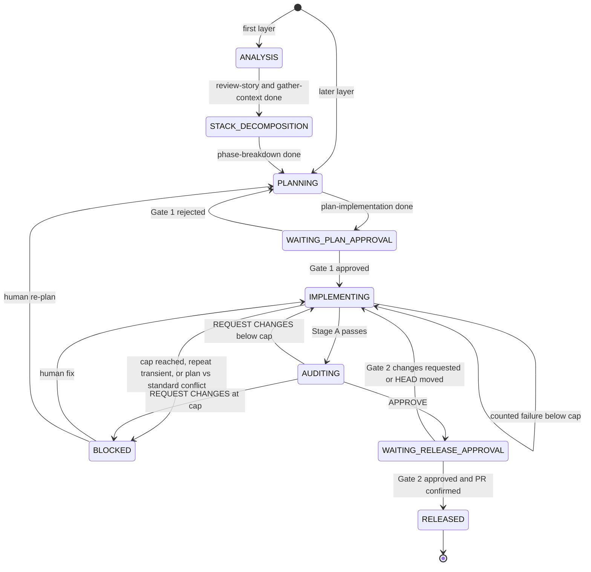

# 0001. Orchestrated authoring of stacked PRs with subagents

**Status**: Proposed
**Date**: 2026-10-13

## Context

Today the skills run by hand across thread boundaries. `prepare-handover` writes a handover file that `review-branch` reads in a fresh thread, and `plan-implementation` stops for approval. Large changes need a stack of small PRs, and a person coordinating many layers by hand is the bottleneck.

This ADR covers authoring: from a requirement to each layer being `RELEASED`, meaning that layer's PR is open with the correct base. Maintenance after release (review comments, upstream rebases) is covered in [ADR 0002](0002-stack-maintenance-and-rebasing.md).

The design keeps individual skills as the atomic building blocks and adds one coordinating skill, `orchestrate`, that drives them, owns the state on disk, and stops at two human gates.

## Decision

### D1. Skill set: 18 plus `orchestrate`

- **Removed**: `review-pr` (auditing someone else's PR is outside the authoring lifecycle).
- **Folded**: `plan-testing` into `plan-implementation`, so test scenarios and coverage boundaries live in the plan. `check-compliance` into `check-alignment`.
- **Merged checker**: `check-alignment` is one read-only pass over the actual diff with two sections, Plan fidelity and Standards. Its result is `ALIGNED` or `GAPS`. It never edits code or the plan. Standards runs without a plan. A conflict between the plan and a standard is reported, not resolved.
- **Kept**: `review-story` (requirements and assumptions before planning), `gather-context` (factual codebase context), `phase-breakdown` (becomes the stack decomposition step), `refactor-code` (on demand).
- **Quality checks**: `simplify-diff` runs at the end of Stage A (D7). `audit-tests` runs on demand only and is not part of the pipeline.
- **New**: `orchestrate`.

### D2. Dispatch

`orchestrate` is the only dispatcher. `delegate-plan` stays prompt-only: it produces a self-contained prompt and runs nothing.

- The orchestrator sends one self-contained prompt per step to a shipped agent definition, `orchestrate-step`: a generic worker that executes the prompt it is given. It lives in a new `agents/` directory. `setup.py` installs it to `~/.claude/agents/` and `~/.agents/agents/`. Cursor reads `~/.claude/agents/`.
- Each step starts fresh. A step is never forked from the orchestrator's context.
- Fallback: if the host has no subagent support or `orchestrate-step` is not installed, the orchestrator prints the prompt in a fenced block and stops, so a person can run it in a fresh thread.
- Skills name no host tools, and the docs name no host as an example of either mode.
- `review-branch` always runs in a fresh subagent so the reviewer shares no context with the implementer.

### D3. Stack and release

Large work is split into small, independently reviewable diffs, authored bottom to top.

- **Tracking**: the stack is tracked locally from the start. Layer 0 is created with `gh stack init`, later layers with `gh stack add`.
- **Open-layer cap**: at most 3 layers may be released but unmerged. `PENDING` layers do not count, and there is no limit on total layers. Before branching the next layer, if 3 are open, the orchestrator halts with "waiting on merge of <bottom PR>" and resumes with `gh stack sync` after that PR merges. Merge state is read live with `gh pr view --json state`. The number 3 is a judgment call (open item 7).
- **Release**: at Gate 2, `create-pr` opens the layer's PR with base `git_anchor.target_branch` (the trunk for layer 0). Once two or more PRs exist, `gh stack sync` links them into the native stack. Neither `gh stack link` nor `gh stack submit` is used. `RELEASED` is confirmed by `gh stack view` and `gh pr view --json state,baseRefName`, which must show the PR open with the right base.
- **Failure**: a failed push or sync is re-run unchanged, and the phase does not advance until the check above passes. `gh stack init <branches>` re-adopts branches if local tracking is lost.
- **gh-stack**: the official `github/gh-stack` extension, v0.2.x, in public preview. It is a hard dependency with no plain-git fallback. If it is missing, the orchestrator stops and tells the user to install it. Known limits: linear history, same-repository branches, no auto-merge yet, at most 100 PRs. Per-repository enablement cannot be read from the API, so the first stack command is the check, and an error stops the run with a message to the user. No merge method is required: GitHub supports all three, and for merged layers the rebase uses `--onto`.

### D4. State on disk

State lives outside the repository in `~/.agent-workflows/<repo>/`, so working trees stay clean and multiple worktrees share it.

```
stacks/<name>/stack.json
<branch>/state.json
<branch>/plan.md
<branch>/handover.md
<branch>/roadblocks.md
```

- `stack.json` is the roadmap: the epic, ordered layers, and the active layer.
- `state.json` is the ledger for one branch. It has a fixed shape of scalars and fixed keys, with no arrays that grow.
- `plan.md` and `handover.md` are the human-readable evidence.
- `roadblocks.md` is append-only. Each entry records a timestamp, the failing skill, the tip SHA, and the root cause.
- Each file has a single writer. The `orchestrate` thread writes `stack.json`. The thread driving a branch writes that branch's `state.json`. Everything else reads. If a second writer is ever added, guard the file with an `mkdir` lock, because `flock` is not available on macOS.
- All SHAs are full 40-character values.
- Writes go to a temp file in the same directory, then a rename:

```bash
dir="$HOME/.agent-workflows/<repo>/<branch>"
tmp="$(mktemp "$dir/state.json.XXXXXX")"
cat > "$tmp" <<'EOF'
{ ... }
EOF
mv -f "$tmp" "$dir/state.json"
```

- **Lifecycle**: a branch's state is read-only after `RELEASED`. `orchestrate` deletes the branch directory when its PR merges or closes, and deletes `stack.json` when the last layer merges. It detects both from the live read at resume or at the open-layer cap check.

### D5. Schemas

Stack manifest, `stacks/<name>/stack.json`. A layer's `status` is `PENDING`, `ACTIVE`, or `RELEASED`. There is no `MERGED` value, because merge state is read live from GitHub.

```json
{
  "schema_version": 1,
  "stack_name": "user-auth-epic",
  "trunk": "main",
  "active_layer_index": 1,
  "layers": [
    { "index": 0, "branch": "feat/auth-models", "pr": 101, "status": "RELEASED" },
    { "index": 1, "branch": "feat/auth-endpoints", "pr": null, "status": "ACTIVE" },
    { "index": 2, "branch": "feat/auth-ui", "pr": null, "status": "PENDING" }
  ],
  "updated_at": "2026-10-13T00:00:00Z"
}
```

Branch ledger, `<branch>/state.json`:

```json
{
  "schema_version": 1,
  "git_anchor": {
    "repo": "agent-workflows",
    "branch": "feat/auth-endpoints",
    "target_branch": "feat/auth-models",
    "base_sha": "b4e6975b23b56dbfeca9f10f250dc66ffae76e90",
    "branch_tip_sha": "f3367fc8b9b5af8570cf822440944d0496b38d11"
  },
  "lifecycle": { "phase": "WAITING_PLAN_APPROVAL", "active_skill": "plan-implementation" },
  "gates": { "gate_1_plan_approved": false, "gate_2_release_approved": false },
  "retries": { "count": 0, "max_allowed": 2 },
  "artifacts": {
    "plan_file": "plan.md",
    "handover_file": "handover.md",
    "roadblocks_file": "roadblocks.md",
    "last_verdict": null,
    "approved_sha": null
  },
  "updated_at": "2026-10-13T00:00:00Z"
}
```

- `base_sha` is the target's tip when the branch was last based on it.
- `branch_tip_sha` is updated after every orchestrator commit.
- `approved_sha` is `HEAD` when `review-branch` returns `APPROVE`. It is cleared on any return to `IMPLEMENTING`.

### D6. Lifecycle state machine



- The phase enum is the set of states above. A branch's `lifecycle.phase` holds one of them.
- A phase is written only after its action succeeds. A handoff that is still waiting, or a failed push or sync, leaves the phase unchanged.
- On resume, the orchestrator reconciles the ledger against git and PR evidence before acting (D10).
- A return from Gate 2 because `HEAD` moved is not a counted retry.

### D7. Verification loop

Polishing happens before review, so the reviewer sees the diff that will ship.

**Stage A**, per layer:

1. Implement.
2. `validate-commit`.
3. `check-alignment`.
4. `simplify-diff`.
5. The orchestrator applies the Safe Cuts and Simplifications that stay within the Gate 1 plan scope. Scope Reductions are not applied; they are listed for Gate 2.
6. `validate-commit`, then `check-alignment` again.
7. `prepare-handover`.

**Stage B**: `review-branch` in a fresh subagent. `APPROVE` records `approved_sha`. `REQUEST CHANGES` returns to implementing (D9).

### D8. Human gates

Exactly two gates:

1. **Gate 1** (`WAITING_PLAN_APPROVAL`): the human approves the plan, dependencies, and blast radius. No code is written before `gate_1_plan_approved` is `true`.
2. **Gate 2** (`WAITING_RELEASE_APPROVAL`): the human sees the approved diff (`HEAD` equals `approved_sha`), the `review-branch` verdict, the validation evidence, and the listed Scope Reductions. No PR is created before `gate_2_release_approved` is `true`. If `HEAD` no longer equals `approved_sha`, the layer returns to `IMPLEMENTING`.

### D9. Retries

One counter, `retries.max_allowed` = 2, giving at most 3 attempts. On a counted failure: if `count >= max_allowed`, set `BLOCKED`. Otherwise increment `count`, append to `roadblocks.md`, and return to `IMPLEMENTING`.

- **Counted**: a handed-off tip that still fails after the implementer's single fix pass. That means an in-scope `validate-commit` failure after its auto-fix, `check-alignment` `GAPS` after one fix pass and a re-run, or `review-branch` `REQUEST CHANGES`.
- **Not counted**: formatter fixes, unrelated or pre-existing failures (logged), and Suggestions or Nitpicks.
- **Transient** (timeout, network, rate limit, host crash): one unchanged re-run, not counted. A second transient failure sets `BLOCKED`.
- **Plan vs standard conflict**: straight to `BLOCKED`.
- **Reset**: a human exit from `BLOCKED` resets `count` to 0, so the cap applies per stint. The orchestrator never resets it. `roadblocks.md` keeps the history.

### D10. Drift checks

On every boot, before any edit:

1. **Tip check (halt)**: `git branch --show-current` must equal `git_anchor.branch` and `git rev-parse HEAD` must equal `branch_tip_sha`. A mismatch halts the run, leaves the phase unchanged, and is reported.
2. **Base check (classify)**, against the local target ref with no fetch:
   - `git rev-parse <target>` equals `base_sha`: in sync.
   - `git merge-base --is-ancestor <base_sha> <target>` succeeds: upstream advanced, so rebase onto the target.
   - Otherwise: upstream was rewritten, so run `git rebase --onto <target> <base_sha>`.

After a rebase, set `base_sha` to the target tip and `branch_tip_sha` to `HEAD`, then re-run `validate-commit`. A conflict sets `BLOCKED`.

### D11. Reference, don't duplicate

Prompts sent to subagents point at `skills/<name>/SKILL.md` rather than copying it. `agents/` holds only the generic `orchestrate-step`.

### D12. Human role

The human acts as technical lead at five touchpoints: define intent and scope (`review-story`), approve the plan (Gate 1), resolve `BLOCKED`, approve the release (Gate 2), and codify lessons (`distill-lessons`). The human also owns stack maintenance after release (ADR 0002).

## Consequences

- `gh stack` is a hard dependency, and it is in preview.
- Each stint allows 3 attempts before the human is involved.
- Skills and docs change when this is implemented:
  - Skills: `create-pr` accepts a base branch, `check-compliance` merges into `check-alignment`, `orchestrate` is added, `agents/orchestrate-step` is added, and `setup.py` installs the agent.
  - Docs to update: the `AGENTS.md` skill count, table rows, and rubric reference at line 14; the `README.md` skill list; the `LIFECYCLE.md` diagram nodes and list; and the directory structure in `README.md` and `AGENTS.md` for `agents/`.

## Open items

| # | Item | Status | What closes it |
| :-- | :-- | :-- | :-- |
| 1 | Automating stack maintenance | Open, manual by design | ADR 0002, or porting `pr-address-comments` later |
| 2 | `create-pr` takes a base branch | Follow-up | Skill change before release works |
| 3 | `orchestrate-step` starts fresh, not forked; install paths (Cursor reads `~/.claude/agents/`, Antigravity reads `~/.agents/agents/`) | Unverified | Try on each host |
| 4 | `gh stack sync` links PRs opened by `create-pr`; `gh stack init` re-adopts branches with non-default bases | Unverified | Scratch-repo trial |
| 5 | gh-stack public preview (v0.2.x); per-repo enablement not readable via API | Risk | First command is the check; revisit at GA |
| 6 | Plain-git drift rebase keeps gh-stack tracking consistent | Unverified | Scratch-repo trial |
| 7 | Open-layer cap of 3 is a judgment call | Open | Revisit if halts are frequent |
| 8 | `prepare-handover` doesn't name the `Branch tip:` label `review-branch` parses | Follow-up | Separate PR off main |
