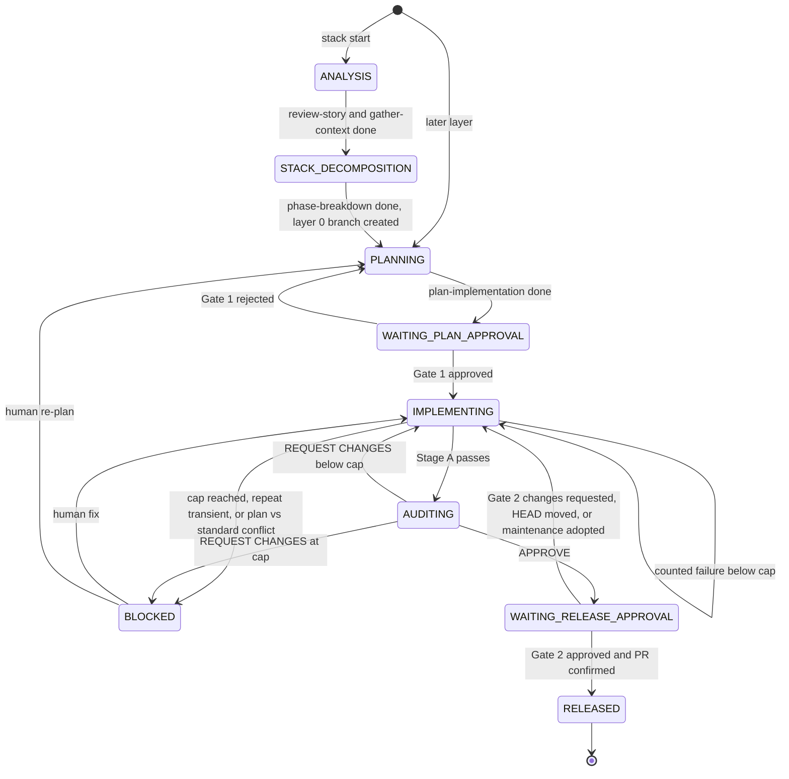

# 0001. Orchestrated authoring of stacked PRs with subagents

**Status**: Proposed
**Date**: 2026-10-13

## Context

Today the skills run by hand across thread boundaries. `prepare-handover` writes a handover file that `review-branch` reads in a fresh thread, and `plan-implementation` stops for approval. Large changes need a stack of small PRs, and a person coordinating many layers by hand is the bottleneck.

This ADR covers authoring: from a requirement to each layer being `RELEASED`, meaning that layer's PR is open with the correct base and, from the second layer on, listed in the remote stack. Maintenance after release (review comments, upstream rebases) is covered in [ADR 0002](0002-stack-maintenance-and-rebasing.md).

The design keeps individual skills as the atomic building blocks and adds one coordinating skill, `orchestrate`, that drives them, owns the state on disk, and stops at two human gates.

## Decision

### D1. Skill set: 18 plus `orchestrate`

- **Removed**: `review-pr` (auditing someone else's PR is outside the authoring lifecycle).
- **Folded**: `plan-testing` into `plan-implementation`, so test scenarios and coverage boundaries live in the plan. `check-compliance` into `check-alignment`.
- **Merged checker**: `check-alignment` is one read-only pass over the actual diff with two sections, Plan fidelity and Standards. Its result is `ALIGNED` or `GAPS`. It never edits code or the plan. Standards runs without a plan. A conflict between the plan and a standard is reported, not resolved.
- **Kept**: `review-story` (requirements and assumptions before planning), `gather-context` (factual codebase context), `phase-breakdown` (becomes the stack decomposition step), `refactor-code` (on demand), `create-branch` (unstacked work only; stacked layers are created per D3).
- **Quality checks**: `simplify-diff` runs at the end of Stage A (D7). `audit-tests` runs on demand only and is not part of the pipeline.
- **New**: `orchestrate`.

### D2. Dispatch

`orchestrate` is the only dispatcher. `delegate-plan` stays prompt-only: it produces a self-contained prompt and runs nothing.

- The orchestrator sends one self-contained prompt per step to a shipped agent definition, `orchestrate-step`: a generic worker that executes the prompt it is given. Its Markdown source lives in a new `agents/` directory.
- `setup.py` installs it per host:
  - Claude Code: `~/.claude/agents/orchestrate-step.md`.
  - Cursor: reads `~/.cursor/agents/`, `~/.claude/agents/` and `~/.codex/agents/`, and uses the Claude Code file. Whether it errors on or double-lists the Codex TOML is unverified (open item 1).
  - Antigravity: `~/.gemini/config/agents/orchestrate-step/agent.md` (directory layout).
  - Codex: `~/.codex/agents/orchestrate-step.toml` with `name`, `description` and `developer_instructions`, generated from the Markdown source.
  - Copilot CLI and VS Code: `~/.copilot/agents/orchestrate-step.agent.md`. The Copilot cloud agent has no user-level path and is out of scope.
  - Windsurf has no subagents and uses the printed-prompt fallback.
- `setup.py` must also:
  - Install Copilot user-level skills to `~/.copilot/skills` (directory-based), not as `.agent.md` files in `~/.copilot/agents`, which makes each skill a custom agent.
  - Clean orphans with a per-target name set (agent names for agent directories, skill names for skill directories), because `sync_target_directory` deletes any managed item whose name is not a folder under `skills/`.
  - Put a `# source: agent-workflows` line in the first 5 lines of the Codex TOML so it counts as managed.
- Each step starts fresh. A step is never forked from the orchestrator's context. Fresh context is documented on Claude Code (invoking `orchestrate-step` by name starts fresh; Claude Code forks only for the `fork` subagent type, which interactive sessions request by default), Cursor, and Antigravity. It is unverified on Codex (openai/codex#20077 reports `spawn_agent` defaults to a full-history fork unless `fork_turns: "none"`) and on Copilot CLI (open item 1).
- Fallback: if the host has no subagent support or `orchestrate-step` is not installed, the orchestrator prints the prompt in a fenced block and stops, so a person can run it in a fresh thread.
- Skills name no host and no host tools. Host specifics live only in `setup.py` and this ADR.
- `review-branch` always runs in a fresh subagent so the reviewer shares no context with the implementer.

### D3. Stack and release

Large work is split into small, independently reviewable diffs, authored bottom to top.

- **Scope**: github.com only. GitHub Enterprise Server is unsupported until GitHub ships stacked PRs there. Stacked PRs are generally available on github.com since 2026-10-06 (GitHub changelog). Auto-merge for stacks is still rolling out (changelog; not trial-tested).
- **gh-stack**: the official `github/gh-stack` extension, minimum v0.2.1. It is a hard dependency with no plain-git fallback. If it is missing or older, the orchestrator stops and tells the user to install or upgrade it. Documented limits, not trial-tested: linear history, same-repository branches, at most 100 PRs. All three merge methods work (observed, see ADR 0002 D1 step 7).
- **Availability**: before the first stack command, `gh api repos/<o>/<r>/stacks` must return 200 (body `[]` when the repository has no stacks; observed 200 on public, private personal, and fork repositories). Anything else stops the run. 404 is the documented response when stacked PRs are unavailable, and gh-stack treats it so (exit 9; unverified). 404 is also returned for a nonexistent repository or one the token cannot read, so the stop message tells the user to check `gh auth status`, `GH_TOKEN`, `GH_REPO` and the remote. A 200 does not prove a fork can be stacked (cross-fork stacks are unsupported).
- **Tracking**: `orchestrate` creates every layer with `gh stack init <branch>` (layer 0) or `gh stack add <branch>` (later layers), naming branches from the plan. Neither command has a prefix option, and `create-branch` is not used. Before `init`, fetch and fast-forward the local trunk, because `init` bases layer 0 on the local default branch without fetching (inferred from source). `gh stack add` must run from the top layer and fails on a detached HEAD (observed: exit 2, nothing created). A non-interactive `init` does not enable rerere (observed; the gh-stack README says it does, source says interactive only).
- **Open-layer cap**: at most 3 layers may be released but unmerged. `PENDING` layers do not count, and there is no limit on total layers. Before branching the next layer, if 3 are open, the orchestrator halts with "waiting on merge of <bottom PR>" and resumes after that PR merges with `git fetch origin`, the ADR 0002 D1 step 1 remote-only-commit check, then `gh stack rebase --upstack` (gh-stack issue #512, replay of merged commits, did not reproduce). Merge state is read live with `gh pr view --json state`. The cap is fixed at 3 and is revisited only if a human reports it as a bottleneck.
- **Release**: at Gate 2, `create-pr` opens the layer's PR with base `git_anchor.target_branch` (the trunk for layer 0). `create-pr` must take an optional base (with no base it omits `--base`; it stops if the base is missing on origin and verifies `baseRefName` after creating the PR) and a keep-checkout option that skips its worktree release. The orchestrator always passes keep-checkout, so the branch stays checked out for the D10 checks and `gh stack add`. In a linked worktree the orchestrator may detach once, after the last layer is `RELEASED`, never earlier. The skill change is a separate follow-up. Once two or more PRs exist, `gh stack link <every open layer PR, bottom to top>` creates or updates the remote stack and repairs wrong bases. `gh stack sync` and `gh stack submit` are not used for release.
- **Link facts** (observed): `gh stack link` takes no `-R` and runs inside the clone. It creates a new stack from unstacked PRs. It pushes with `git push --atomic` and no force, so a non-fast-forward is rejected, nothing is pushed, and the exit code is 1. A failed link is re-run after resolving the cause. A locally amended or rebased layer with no divergent remote is expected to be rejected the same way (unverified).
- **RELEASED**: `gh pr view --json state,baseRefName` shows the PR open with the right base, and `gh api 'repos/<o>/<r>/stacks?pull_request=<N>'` lists the PR. Layer 0 alone needs only the base check. Exit codes are not evidence of success for `gh stack sync` or `gh stack view`.
- **Failure**: a failed `create-pr` or link is re-run after the cause is resolved, and the phase does not advance until the RELEASED check passes. If local tracking is lost, `gh stack init <every unmerged layer, bottom to top>` re-adopts the branches and finds their PRs (observed). A partial list leaves the stack unreconciled with exit 0. A list that includes a merged layer makes `gh stack sync` fail on a conflict.

### D4. State on disk

State lives outside the repository in `~/.agent-workflows/<repo>/`, so working trees stay clean and multiple worktrees share it.

```
stacks/<name>/stack.json
stacks/<name>/requirements.md
<branch>/state.json
<branch>/plan.md
<branch>/handover.md
<branch>/roadblocks.md
```

- `stack.json` is the roadmap: the phase, the ordered layers, and the active layer. `orchestrate` creates it at start with phase `ANALYSIS`, `layers: []` and `active_layer_index: null`.
- `requirements.md` holds the human's `review-story` answers, written by the orchestrator so a re-run of `ANALYSIS` does not lose them.
- `state.json` is the ledger for one branch. It has a fixed shape of scalars and fixed keys, with no arrays that grow.
- `plan.md` and `handover.md` are the human-readable evidence. Who writes `plan.md` is unresolved (open item 2).
- `roadblocks.md` is append-only. Each entry records a timestamp, the failing skill, the tip SHA, and the root cause.
- Branch directories are `<branch>/` with every `/` in the name a nested directory. Git forbids `feat` alongside `feat/x`, so branch directories do not collide. A branch named `stacks` or starting `stacks/` stops the run.
- Single writer: the `orchestrate` thread writes `stack.json` and every `state.json`. Workers write only evidence files (such as `handover.md`). Everything else reads. If a second writer is ever added, guard the file with an `mkdir` lock, because `flock` is not available on macOS.
- All SHAs are full 40-character values.
- Writes go to a temp file in the same directory, then a rename:

```bash
dir="$HOME/.agent-workflows/<repo>/<branch>"
tmp="$(mktemp "$dir/state.json.XXXXXX")"
cat > "$tmp" <<'EOF'
{ ... }
EOF
mv -f "$tmp" "$dir/state.json"
```

- **Lifecycle**: a branch's state is read-only after `RELEASED`. `orchestrate` deletes the branch directory when its PR merges or closes, and deletes `stack.json` when the last layer merges or when the stack is abandoned before any layer exists. It detects both from the live read at resume or at the open-layer cap check.

### D5. Schemas

Stack manifest, `stacks/<name>/stack.json`. `phase` is `ANALYSIS`, `STACK_DECOMPOSITION`, or `LAYERS`. A layer's `status` is `PENDING`, `ACTIVE`, or `RELEASED`. There is no `MERGED` value, because merge state is read live from GitHub.

```json
{
  "schema_version": 1,
  "stack_name": "user-auth-epic",
  "trunk": "main",
  "phase": "LAYERS",
  "active_layer_index": 1,
  "layers": [
    { "index": 0, "branch": "feat/auth-models", "pr": 101, "status": "RELEASED" },
    { "index": 1, "branch": "feat/auth-endpoints", "pr": null, "status": "ACTIVE" },
    { "index": 2, "branch": "feat/auth-ui", "pr": null, "status": "PENDING" }
  ],
  "updated_at": "2026-10-13T00:00:00Z"
}
```

Branch ledger, `<branch>/state.json`:

```json
{
  "schema_version": 1,
  "git_anchor": {
    "repo": "agent-workflows",
    "branch": "feat/auth-endpoints",
    "target_branch": "feat/auth-models",
    "base_sha": "b4e6975b23b56dbfeca9f10f250dc66ffae76e90",
    "branch_tip_sha": "f3367fc8b9b5af8570cf822440944d0496b38d11",
    "pending_step": null
  },
  "lifecycle": { "phase": "WAITING_PLAN_APPROVAL", "active_skill": "plan-implementation" },
  "gates": { "gate_1_plan_approved": false, "gate_2_release_approved": false },
  "retries": { "count": 0, "max_allowed": 2 },
  "artifacts": {
    "plan_file": "plan.md",
    "handover_file": "handover.md",
    "roadblocks_file": "roadblocks.md",
    "last_verdict": null,
    "approved_sha": null
  },
  "updated_at": "2026-10-13T00:00:00Z"
}
```

- `base_sha` is the target's tip when the branch was last based on it.
- `branch_tip_sha` is the last `HEAD` the orchestrator verified. Only the orchestrator writes it.
- `pending_step` is `null` or `{ "step_id", "skill", "from_tip_sha" }`, a fixed object. Before dispatching a step that may commit or move `HEAD`, the orchestrator writes `pending_step` (D4 atomic write). After the step returns it reads `git rev-parse HEAD` itself (a subagent returns only text, so a reported SHA is a cross-check only), then writes `branch_tip_sha` = `HEAD` and clears `pending_step` in one write.
- `approved_sha` is `HEAD` when `review-branch` returns `APPROVE`. It is cleared on any return to `IMPLEMENTING`.

### D6. Lifecycle state machine



- `ANALYSIS` and `STACK_DECOMPOSITION` are recorded in `stack.json` `phase`. Decomposition fills `layers`, then sets `phase` to `LAYERS`. Layer 0's branch is created only after that. A branch's `lifecycle.phase` holds one of the remaining states and starts at `PLANNING`.
- A phase is written only after its action succeeds. A handoff that is still waiting, or a failed `create-pr` or link, leaves the phase unchanged.
- On resume, the orchestrator reconciles the ledger against git and PR evidence before acting (D10).
- A return from Gate 2 because `HEAD` moved or maintenance was adopted is not a counted retry.

### D7. Verification loop

Polishing happens before review, so the reviewer sees the diff that will ship.

**Stage A**, per layer:

1. Implement.
2. `validate-commit`.
3. `check-alignment`.
4. `simplify-diff`.
5. The orchestrator dispatches one `orchestrate-step` that applies the Safe Cuts and Simplifications from the `simplify-diff` report (passed verbatim), fenced to the Gate 1 plan scope and committed separately. Scope Reductions are not applied; they are listed for Gate 2. The orchestrator edits no code.
6. `validate-commit`, then `check-alignment` again. If either fails after the cuts, reset the branch to the pre-cut tip (`git reset --hard`, not revert, because nothing is pushed yet), log it in `roadblocks.md`, and continue.
7. `prepare-handover`, which writes `Branch tip: <full 40-char SHA>` as the first line of the handover. `review-branch` prefix-matches it against `HEAD`.

**Stage B**: `review-branch` in a fresh subagent. `APPROVE` records `approved_sha`. `REQUEST CHANGES` returns to implementing (D9).

### D8. Human gates

Exactly two gates:

1. **Gate 1** (`WAITING_PLAN_APPROVAL`): the human approves the plan, dependencies, and blast radius. No code is written before `gate_1_plan_approved` is `true`.
2. **Gate 2** (`WAITING_RELEASE_APPROVAL`): the human sees the approved diff (`HEAD` equals `approved_sha`), the `review-branch` verdict, the validation evidence, and the listed Scope Reductions. No PR is created before `gate_2_release_approved` is `true`. If `HEAD` no longer equals `approved_sha`, the layer returns to `IMPLEMENTING`.

### D9. Retries

One counter, `retries.max_allowed` = 2, giving at most 3 attempts. On a counted failure: if `count >= max_allowed`, set `BLOCKED`. Otherwise increment `count`, append to `roadblocks.md`, and return to `IMPLEMENTING`.

- **Counted**: a handed-off tip that still fails after the implementer's single fix pass. That means an in-scope `validate-commit` failure after its auto-fix, `check-alignment` `GAPS` after one fix pass and a re-run, or `review-branch` `REQUEST CHANGES`.
- **Not counted**: formatter fixes, unrelated or pre-existing failures (logged), Suggestions or Nitpicks, and a failure caused only by the cut step.
- **Transient** (timeout, network, rate limit, host crash): one unchanged re-run, not counted. A second transient failure sets `BLOCKED`.
- **Plan vs standard conflict**: straight to `BLOCKED`.
- **Reset**: a human exit from `BLOCKED` resets `count` to 0, so the cap applies per stint. The orchestrator never resets it. `roadblocks.md` keeps the history.

### D10. Drift checks

On every boot, before any edit, in order:

0. **Clean tree (halt)**: `git status --porcelain` is empty and no rebase, merge, or cherry-pick is in progress (no `rebase-merge`, `rebase-apply`, `MERGE_HEAD`, or `CHERRY_PICK_HEAD` in the git dir).
1. **Branch (halt)**: `git branch --show-current` equals `git_anchor.branch`. A detached HEAD halts and is reported as such.
2. **Tip**: `HEAD` equals `branch_tip_sha`: if `pending_step` is set, the step never committed, so clear it and re-run the step (not counted). Then go to the base check.
3. **Moved tip**:
   - **(a) Crash**: `pending_step` is set and `git merge-base --is-ancestor <from_tip_sha> HEAD` succeeds. Set `branch_tip_sha` = `HEAD`, clear `pending_step`, and re-run the step (a transient re-run per D9, not counted).
   - **(b) Maintenance**: the phase is `WAITING_PLAN_APPROVAL`, `WAITING_RELEASE_APPROVAL`, or `BLOCKED`, and all of these hold: the old `base_sha` and `branch_tip_sha` objects exist; `git merge-base --is-ancestor <P> HEAD` where `P` = `git rev-parse <target_branch>`; `git rev-list --merges P..HEAD` is empty; and the ordered `git patch-id --stable` list of `base_sha..branch_tip_sha` equals that of `P..HEAD`. Then set `base_sha` = `P`, `branch_tip_sha` = `HEAD`, `approved_sha` = `null`, append a `roadblocks.md` entry, and if the phase was `WAITING_RELEASE_APPROVAL` return to `IMPLEMENTING`. Approval is not carried over: a patch-identical diff on a changed parent re-runs Stage A and review. This is not a counted retry.
   - **(c) Otherwise halt**: leave the phase unchanged and report the old and new tips and the first differing patch.

   Observed in trials: clean cascades and a reword-only amend are accepted by (b). A conflict-resolved rebase, a dropped commit, a squash, an extra commit, an added merge commit, and a parent that is not an ancestor are halted. A human who accepts the new `HEAD` (for example after resolving a conflict) tells the orchestrator to adopt it, which performs the (b) writes. This is a documented step, not a new command.
4. **Base check (classify)**, against the local target ref with no fetch:
   - `git rev-parse <target>` equals `base_sha`: in sync.
   - `git merge-base --is-ancestor <base_sha> <target>` succeeds: upstream advanced, so rebase onto the target.
   - Otherwise: upstream was rewritten.

   Rebase commands:
   - Layer 0 uses plain git: `git rebase <target>` when upstream advanced, `git rebase --onto <target> <base_sha>` when it was rewritten.
   - Layers 1 and up use `gh stack rebase --upstack <branch> --no-trunk` in both cases. It rebases `<branch>` onto its parent and uses its recorded parent SHA when the parent was rewritten (read in source; observed after rewriting layer 0: exit 0, no conflicts). `--no-trunk` never rebases layer 0 and does not fetch.

After a rebase, set `base_sha` = `git rev-parse <target>` and `branch_tip_sha` = `git rev-parse <branch>`, never from gh-stack's state, then re-run `validate-commit`. A conflict sets `BLOCKED`.

### D11. Reference, don't duplicate

Prompts sent to subagents point at `skills/<name>/SKILL.md` rather than copying it. `agents/` holds only the generic `orchestrate-step`.

### D12. Human role

The human acts as technical lead at five touchpoints: define intent and scope (`review-story`), approve the plan (Gate 1), resolve `BLOCKED`, approve the release (Gate 2), and codify lessons (`distill-lessons`). The human also owns stack maintenance after release (ADR 0002), which runs only while no orchestrator run is acting on the stack. The orchestrator re-anchors on its next boot (D10 step 3b).

## Consequences

- gh-stack v0.2.1+ and github.com are required.
- Each stint allows 3 attempts before the human is involved.
- Every stack step is confirmed by reading GitHub state, not by exit code.
- The orchestrator edits no code and is the only writer of `stack.json` and `state.json`. Every tip it records was read from git by the orchestrator.
- A step interrupted after committing is recovered at the next boot (D10 step 3a). A branch moved by maintenance is adopted only when its patches are unchanged (D10 step 3b), and approval is never carried over.
- The open-layer cap resume keeps `git fetch origin`, the remote-only-commit check, then `gh stack rebase --upstack`, consistent with #512 not reproducing.
- `setup.py` and `create-pr` need changes before this design is implementable (D2, D3).

## Open items

| # | Item | Status | What closes it |
| :-- | :-- | :-- | :-- |
| 1 | Fresh context on Codex and Copilot CLI, and Cursor's handling of the Codex TOML | Unverified | Canary trial: tell the caller a code word, then ask the named `orchestrate-step` to report any it knows |
| 2 | Who writes `plan.md` | Unresolved | A decision |
| 3 | How `stack_name` is derived (filesystem-safe, unique) | Unresolved | A decision |
