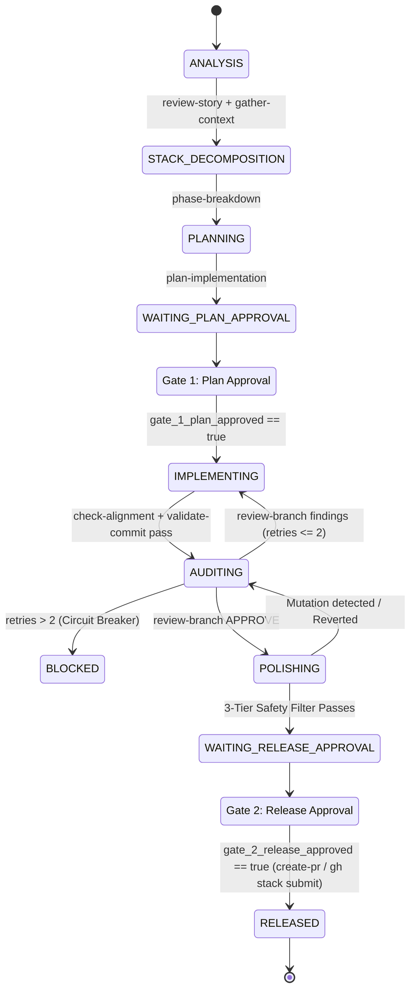

# Architecture Decisions: Orchestrator-Subagent Evolution

**Date**: 2026-09-18  
**Status**: Decided  
**Context**: Strategic evaluation of transitioning `agent-workflows` from manual skill execution across thread boundaries to an automated, universally portable AI Orchestrator managing PR stacks and subagents.  
**Scope**: Feature authoring through layer release (`gh stack submit`). Asynchronous remote PR review triage and post-release stack rebasing are out of scope (see [0002-stack-maintenance-and-rebasing.md](0002-stack-maintenance-and-rebasing.md)).

---

### 1. Dual-Layer Strategy & Consolidated Skills Matrix
* **Evolution, Not Pivot**: Individual skills remain the atomic, executable building blocks. A top-level `orchestrate` skill coordinates multi-PR stacks and lifecycle transitions without proprietary lock-in.
* **Consolidated 18+1 Skills Architecture**: Skills are pruned and consolidated to maintain high signal-to-noise and eliminate redundancy:
  * **Pruned (1)**: `review-pr` removed (external PR auditing is outside the feature/PR authoring lifecycle).
  * **Folded/Merged (2)**:
    * `plan-testing` folded into `plan-implementation` (test scenarios and coverage boundaries are planned directly in the implementation plan).
    * `check-compliance` merged into `check-alignment` (verifies both plan fidelity and repository guideline compliance in a single post-implementation step).
  * **Elevated Inception Skills (2)**:
    * `review-story` elevated as the cognitive requirement/assumptions/clarifying questions gate before planning.
    * `gather-context` kept distinct for factual codebase context ingestion.
  * **Pivoted Stack Gate (1)**: `phase-breakdown` transformed into the PR Stack Decomposition gate.
  * **Hygiene & Verification (3)**:
    * `simplify-diff` and `audit-tests` retained as distinct, modular quality checks run sequentially during post-review polish.
    * `refactor-code` retained as an on-demand structural tool for deep architectural restructuring.
  * **New Top-Level Coordinator (1)**: `orchestrate` guides the developer, manages the PR stack, and dispatches subagents or handoff blocks.

---

### 2. Universal Portability & Dual-Mode Coordination
* **No Proprietary API Lock-in**: The orchestrator operates independently of any platform's private subagent spawning APIs.
* **Dual-Mode Execution**:
  * *Automated Dispatch*: In environments with native subagent tooling (e.g., Antigravity, Claude Code), the orchestrator automatically invokes subagents via `delegate-plan`.
  * *Handoff Prompts*: In single-thread environments (e.g., Cursor, Windsurf), the orchestrator emits self-contained, fenced prompt blocks for the developer to run in fresh threads.
* **Guaranteed Context Isolation**: Both execution modes enforce physical context separation for `review-branch` to prevent confirmation bias and context window degradation.

---

### 3. PR & Stack Decomposition Protocol (`phase-breakdown`)
* **Small-Diff Standards**: To prevent context window bloat, large diffs, and reviewer fatigue, large tasks are never implemented as a single monolithic PR.
* **Stack Decomposition**: `phase-breakdown` divides an epic into an ordered chain of small, independently reviewable stacked PRs following GitHub CLI stacked PR conventions (`gh-stack`).
* **Sequential Layer Execution**: The orchestrator iterates through the stack bottom-to-top, executing the full implementation, audit, and release cycle for each layer before advancing to the next.

---

### 4. Two-Tier Hierarchical State-on-Disk Protocol
* **Location**: Stored outside the repository in `~/.agent-workflows/<repo>/` to keep working trees clean, untracked, and multi-worktree safe.
* **Two-Tier Architecture**:
  1. **Stack Manifest (`stacks/<stack-name>/stack.json`)**: High-level roadmap tracking the epic, ordered branch layers, and overall stack completion.
  2. **Branch Ledger (`<branch>/state.json`)**: Ultra-compact ($\le 35$ lines), machine-verifiable state tracking the active layer's micro-lifecycle FSM, gates, and git anchors.
* **Human Evidence Files**: Detailed Markdown artifacts (`plan.md`, `handover.md`) stored alongside the ledger.
* **Atomic Writes**: Transitions use the universal temp-and-swap pattern:
  ```bash
  cat << 'EOF' > state.json.tmp && mv state.json.tmp state.json
  ```

---

### 5. Staged Hybrid Verification Loop & 3-Tier Post-Review Safety Filter
To resolve the tension between premature optimization (wasted polish on rejected code) and the "post-review invalidation hazard" (shipping unreviewed cuts), the orchestrator implements **Approach 3 (The Staged Hybrid Model)**:

1. **Stage A: Make It Work & Baseline Verification**:
   * Implement code and tests.
   * Run `check-alignment` (scope + standards compliance) and `validate-commit` (compilation, linters, and unit tests pass).
   * Skip heavy simplification during early iterative review loops to avoid wasted tokens.
2. **Stage B: Architectural & Behavioral Audit (`review-branch`)**:
   * Independent auditor evaluates functional correctness, edge cases, and domain logic in an isolated context window.
   * If changes are requested $\rightarrow$ fix logic $\rightarrow$ re-run baseline validation $\rightarrow$ re-audit.
3. **Stage C: Post-Review Polish & De-bloating**:
   * Once `review-branch` grants an `APPROVE` verdict:
     * Run `simplify-diff` to strip over-engineered abstractions, unused helpers, and speculative scaffolding.
     * Run `audit-tests` to ensure test assertions are meaningful (no tautologies, no over-mocking).
4. **The 3-Tier Safety Filter (Automated Regression Guard)**:
   * **Tier 1 (Static Invariants)**: Zero new public exports/signatures; strict type checks pass.
   * **Tier 2 (Regression Parity)**: Re-run `validate-commit` (100% test suite pass).
   * **Tier 3 (Micro-Semantic Diff Classifier)**: The orchestrator sends *only the delta diff* (`git diff <approved-sha>..<cleaned-sha>`) to a fast/flash subagent to confirm it is strictly a behavior-preserving cut.
   * **Auto-Revert Fail-Safe**: If Tier 3 flags a behavioral mutation, the cleanup commit is reverted immediately to the approved state.

---

### 6. Canonical Schemas & FSM

#### A. Stack Manifest Schema (`stacks/<stack-name>/stack.json`)
```json
{
  "$schema": "https://json-schema.org/draft/2020-12/schema",
  "schema_version": 1,
  "stack_name": "user-auth-epic",
  "trunk": "main",
  "active_layer_index": 1,
  "layers": [
    { "index": 0, "branch": "feat/auth-models", "pr": 101, "status": "RELEASED" },
    { "index": 1, "branch": "feat/auth-endpoints", "pr": null, "status": "IMPLEMENTING" },
    { "index": 2, "branch": "feat/auth-ui", "pr": null, "status": "PENDING" }
  ],
  "updated_at": "2026-09-18T00:00:00Z"
}
```

#### B. Branch Ledger Schema (`<branch>/state.json`)
```json
{
  "$schema": "https://json-schema.org/draft/2020-12/schema",
  "schema_version": 1,
  "git_anchor": {
    "repo": "agent-workflows",
    "branch": "feat/auth-endpoints",
    "target_branch": "feat/auth-models",
    "base_sha": "b4e6975",
    "branch_tip_sha": "a1b2c3d"
  },
  "lifecycle": {
    "phase": "WAITING_PLAN_APPROVAL",
    "active_skill": "plan-implementation"
  },
  "gates": {
    "gate_1_plan_approved": false,
    "gate_2_release_approved": false
  },
  "retries": {
    "count": 0,
    "max_allowed": 2,
    "roadblocks": []
  },
  "artifacts": {
    "plan_file": "plan.md",
    "handover_file": "handover.md",
    "last_verdict": null
  },
  "updated_at": "2026-09-18T00:00:00Z"
}
```

#### C. Finite State Machine (FSM)


* **Lifecycle Phase Enum**:
  `ANALYSIS` $\rightarrow$ `STACK_DECOMPOSITION` $\rightarrow$ `PLANNING` $\rightarrow$ `WAITING_PLAN_APPROVAL` $\rightarrow$ `IMPLEMENTING` $\rightarrow$ `AUDITING` $\rightarrow$ `POLISHING` $\rightarrow$ `WAITING_RELEASE_APPROVAL` $\rightarrow$ `RELEASED` (or `BLOCKED`).

---

### 7. Mandatory Human Gates (HITL Gating)
To eliminate token runaway loops and semantic drift, exactly **two human approval gates** are enforced:
1. **Gate 1 (`WAITING_PLAN_APPROVAL`)**: Human approves the architecture, dependencies, and blast radius. Agents are strictly forbidden from writing code until `gate_1_plan_approved` is `true`.
2. **Gate 2 (`WAITING_RELEASE_APPROVAL`)**: Human inspects the isolated audit verdict, test evidence, and polished diff. Agents are strictly forbidden from creating a PR until `gate_2_release_approved` is `true`.

---

### 8. Roadblock Escalation Cap (Max 2 Retries)
* **Automated Self-Correction**: When baseline validation (`validate-commit`) or audit (`review-branch`) fails, `retries.count` increments and the root cause is logged into `retries.roadblocks`.
* **Circuit Breaker**: If `retries.count > 2`, execution halts immediately with `phase: "BLOCKED"`, escalating directly to the human technical lead.

---

### 9. "Reference, Don't Duplicate" Pattern
* Subagents and handoff prompts dynamically reference canonical `skills/<name>/SKILL.md` manifests on demand. No duplicate `agents/` prompt directory is maintained.

---

### 10. High-Leverage Human Role (Tech Lead / Gatekeeper)
The human developer acts as the technical lead and supervisor across 5 key touchpoints:
1. **Define Intent & Scope**: Ground requirements and clarify ambiguities via `review-story`.
2. **Approve Implementation Plans**: Gate 1 sign-off on architecture and test boundaries.
3. **Arbitrate Roadblocks**: Unblock executions halted by the 2-retry circuit breaker.
4. **Final Release Sign-off**: Gate 2 sign-off on polished diffs before PR creation.
5. **Codify Durable Lessons**: Govern long-term repo standards via `distill-lessons`.

---

### 11. Known Operational Challenges & Edge Cases

| # | Challenge | Failure Mode & Risk | Mitigation / Status |
| :--- | :--- | :--- | :--- |
| **1** | **Upstream Stack Rebasing** | Invalidation of downstream branches/plans when upstream changes. | **Resolved**: Authoring FSM bounded to layer release; cascade rebasing delegated out-of-band to [ADR 0002](0002-stack-maintenance-and-rebasing.md). |
| **2** | **Tier 3 Classifier Blind Spots** | LLM-as-a-judge false positives (unnecessary reverts) or false negatives (missed async timing/telemetry mutations). | **Open**: Requires deterministic contract/mutation testing or secondary evaluator heuristics alongside the Flash model. |
| **3** | **Git vs. Ledger Drift** | Out-of-band Git mutations (`reset`, `checkout`, `rebase`) desynchronize `~/.agent-workflows/` ledger. | **Open**: Mandates boot-time reconciliation (`git merge-base` / HEAD vs. `git_anchor`) before allowing code edits. |
| **4** | **Circuit Breaker Ergonomics** | Ephemeral timeouts or linter formatting burn the 2-retry halt limit. | **Open**: Mandates categorized error budgets (deterministic auto-formatters vs. strict functional failure limits). |

